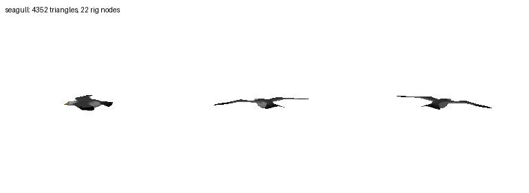
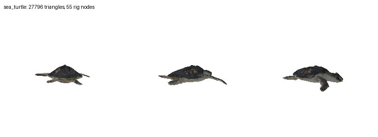

# 本地 video model 與動物樣本

目前有兩個可選 I2V backend；Wan 的程式、設定、權重目錄與影片快取均保留。

| backend | 模型 | 建議起始設定 |
| --- | --- | --- |
| `wan` | Wan 2.2 TI2V 5B | 原本的 1280×704、121 幀 |
| `ltx` | 原始 LTX-Video 2B DiT | 512×288、49 幀、30 steps、CPU offload |

LTX 的 transformer 比 Wan 5B 小，低解析度與較短片段也能降低負擔。
但它仍需 CUDA GPU，T5 text encoder 也會使用 CPU RAM；目前沒有正式 2B
權重的實測 VRAM 數字，不保證每張顯卡都能跑。若不足，可先將寬高降到
384×224、幀數降到 25；品質和動作幅度也可能降低。

此 backend 使用原始 2B checkpoint，並非 13B、LTX-2 或 distilled 8-step 版本。
來源：[官方模型](https://huggingface.co/Lightricks/LTX-Video)、
[Diffusers I2V 介面](https://huggingface.co/docs/diffusers/v0.35.1/en/api/pipelines/ltx_video)。
權重依官方 checkpoint 的 license 提供；可在模型頁查看相應條款。

## 安裝與選擇

先在 Python 3.11+ 環境安裝符合機器 CUDA 的 PyTorch，再安裝：

```bash
pip install -e '.[video]'
# 要跑完整 optimization pipeline，另依 README 安裝 gpu extra / PyTorch3D / supervision。
python scripts/bootstrap.py --video-backend ltx
```

只生成影片（不需要 SAM2、AllTracker、VGGT、PyTorch3D 或 FEM）：

```bash
animimic video --config configs/fox-ltx.yaml --image path/to/canonical.png --output runs/reference-ltx.mp4
```

同一張圖、prompt、seed、backend 與設定會命中快取；改 output 路徑只複製已有影片。
不同 backend 的快取分開；沒有刪除或重用別的 backend 的影片。

## 先檢查原地動作影片

`configs/horse-idle-ltx.yaml` 是馬的原地動作設定：四蹄保持原位、軀幹位置與
方向不變，只做小幅點頭與耳朵動作，鏡頭與背景固定。原本設定仍保留。
這份設定只調整 prompt，解析度、步數、seed 與原本 LTX 預設相同，方便比較。
文字是軟性引導，仍可能生成走動、滑步或外觀改變，需要先看結果。

從上一輪 `runs/horse/<run-id>/manifest.json` 的 `stages.render.directory`
找到 `canonical.png`，用它單獨生成影片：

```bash
bash scripts/07_generate_video.sh path/to/canonical.png configs/horse-idle-ltx.yaml runs/horse-idle-reference.mp4
```

先確認馬的外形、四肢、腳的位置和鏡頭穩定，動作有變化但沒有整隻滑動。
如果不合格，修改 prompt 或 seed 再生成，先不要跑 joint/FEM。
如果合格，在這份 YAML 最外層加入以下設定，再跑完整流程，便會使用該影片：

```yaml
reference_video: runs/horse-idle-reference.mp4
```

```bash
bash scripts/08_run_pipeline.sh configs/horse-idle-ltx.yaml
```

不設定 `reference_video` 時，完整流程會自行生成影片；單獨生成與完整流程的
影片快取目前是不同命名空間，因此先試片後請設定 `reference_video`，避免再次生成。
提高解析度或步數可另外實驗，但不能保證解決動物形變或動作不遵從的問題。

完整 pipeline：

```bash
animimic run --config configs/horse-ltx.yaml
animimic run --config configs/fox.yaml --video-backend ltx
# 原有 Wan：
animimic run --config configs/fox.yaml
```

`--video-backend` 切換時保留 prompt/seed，但重設模型專屬的路徑、幀數和解析度，
以免把 Wan 的 checkpoint 或 121-frame 設定誤套到 LTX。要精確控制時請使用 YAML。

## 八個可下載資產

原本只有三個：Fox、CesiumMan、RobotExpressive。Fox 確實是 576 triangles 的
low-poly fox，現在明確列為 debug；新增五個一般動物形態、帶貼圖的 game assets。
它們不是電影級毛髮模型，也不以多個外觀變體湊樣本數。

| ID | triangles | skin joints | 類型 |
| --- | ---: | ---: | --- |
| `fox` | 576 | 24 | low-poly animal debug |
| `humanoid` | 4,672 | 19 | humanoid debug |
| `robot` | 3,237 | 43 × 2 skins | robot debug |
| `horse` | 32,124 | 65 | 馬，帶鞍 |
| `puppy` | 33,384 | 122 | 帶貼圖的狗 |
| `shark` | 10,000 | 22 | 鼠鯊 |
| `seagull` | 4,352 | 15 | 海鷗 |
| `sea_turtle` | 27,796 | 44 | 肯氏龜 |

新增五個均已實際下載、核對 hash、通過目前 importer、檢查多視角渲染；
其 joint optimization/FEM 品質仍需個別跑實驗，尤其高骨架數與薄翼／鰭部位。

```bash
animimic assets list
animimic assets fetch --asset puppy
animimic assets preview --asset puppy --output runs/asset-previews
animimic run --config configs/puppy-ltx.yaml
```

預覽：





下載走 Objaverse 的個別 GLB，不需要整包資料集或 Sketchfab token。
每個新增資產的原作者、原頁、metadata 出處、CC BY attribution 與固定 SHA-256，
記錄在 `src/animimic/animal_assets.json`，下載後另存 `asset.json`。
馬的來源是 Ayan 的
[Animated Rigged Horse With Saddle](https://sketchfab.com/3d-models/animated-rigged-horse-with-saddle-b08743c2c4734fb98a4e0a2f5767c318)；
其餘原始 metadata 來自
[Objaverse shard 000-000](https://huggingface.co/datasets/allenai/objaverse/blob/main/metadata/000-000.json.gz)。
只提交 manifest 和預覽，不提交 GLB 或論文。
