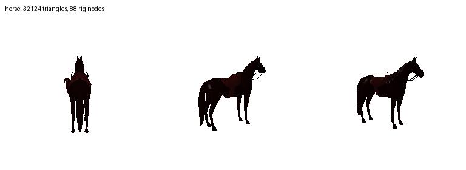
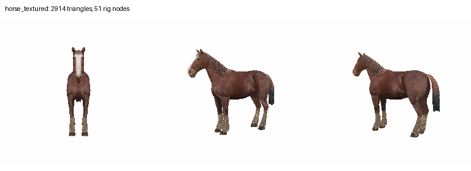
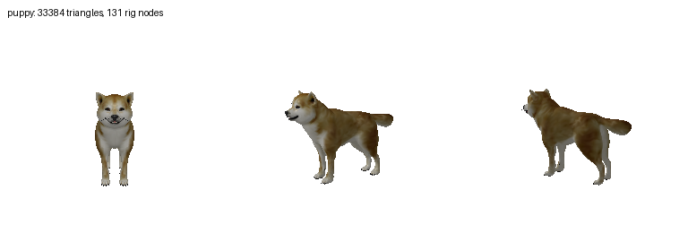
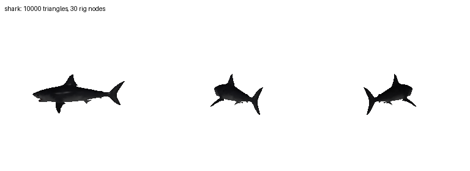

# Wan 影片與可下載資產

完整流程預設使用有毛色貼圖的馬與 Wan 2.2。可先渲染起始圖，再生成影片預覽：

```bash
bash scripts/08_run_pipeline.sh --until-stage render
bash scripts/08_run_pipeline.sh --until-stage video
```

預設設定是 `configs/experiments/horse-textured-wan-leftforeleg-grouped-tracks.yaml`，生成 121 幀、24 fps 的參考影片。換一個動作時，複製設定並修改 `video.prompt`。已經有影片時，在設定加入 `reference_video`。

確認影片後，用同一份設定執行完整流程，讓 pipeline 使用前面生成的影片快取。

```bash
bash scripts/08_run_pipeline.sh
```

## 九個可下載資產

原本只有三個：Fox、CesiumMan、RobotExpressive。Fox 確實是 576 triangles 的
low-poly fox，現在明確列為 debug；另有六個動物資產，外觀品質不同。
其中 horse 主要使用純色材質，唯一的 1024×1024 貼圖是純黑色，沒有毛色細節，
僅適合流程除錯，不應視為寫實貼圖馬。新加入的 `horse_textured` 是另一個模型，
有實際毛色貼圖與 skin；這裡共有五種動物，其中馬有兩個模型。
其餘動物可先查看下方預覽；不以多個外觀變體湊樣本數。

| ID | triangles | skin joints | 類型 |
| --- | ---: | ---: | --- |
| `fox` | 576 | 24 | low-poly animal debug |
| `humanoid` | 4,672 | 19 | humanoid debug |
| `robot` | 3,237 | 43 × 2 skins | robot debug |
| `horse` | 32,124 | 65 | 純色材質的帶鞍馬；外觀除錯用途 |
| `horse_textured` | 2,914 | 42 | 有 2K 毛色紋理的馬；保留完整 UV 貼圖 |
| `puppy` | 33,384 | 122 | 帶貼圖的狗 |
| `shark` | 10,000 | 22 | 鼠鯊 |
| `seagull` | 4,352 | 15 | 海鷗 |
| `sea_turtle` | 27,796 | 44 | 肯氏龜 |

這六個動物資產均已實際下載、核對 hash、通過目前 importer、檢查多視角渲染；
其 joint optimization/FEM 品質仍需個別跑實驗，尤其高骨架數與薄翼／鰭部位。

```bash
animimic assets list
animimic assets fetch --asset puppy
animimic assets preview --asset puppy --output runs/asset-previews
```

預覽：



新馬（完整 UV 貼圖）：






下載走 Objaverse 的個別 GLB，不需要整包資料集或 Sketchfab token。
每個新增資產的原作者、原頁、metadata 出處、CC BY attribution 與固定 SHA-256，
記錄在 `src/animimic/animal_assets.json`，下載後另存 `asset.json`。
馬的來源是 Ayan 的
[Animated Rigged Horse With Saddle](https://sketchfab.com/3d-models/animated-rigged-horse-with-saddle-b08743c2c4734fb98a4e0a2f5767c318)；
其餘原始 metadata 來自
[Objaverse shard 000-000](https://huggingface.co/datasets/allenai/objaverse/blob/main/metadata/000-000.json.gz)。
只提交 manifest 和預覽，不提交 GLB 或論文。
