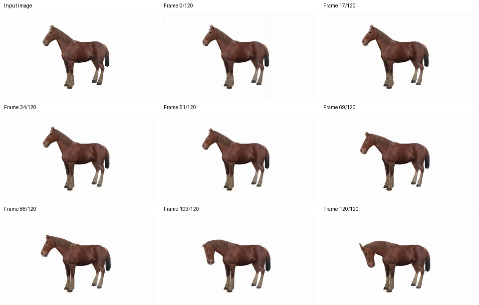
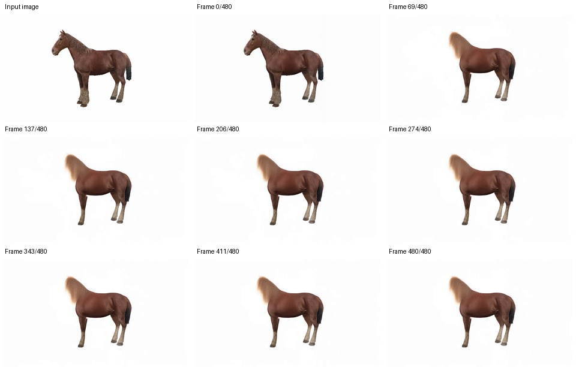
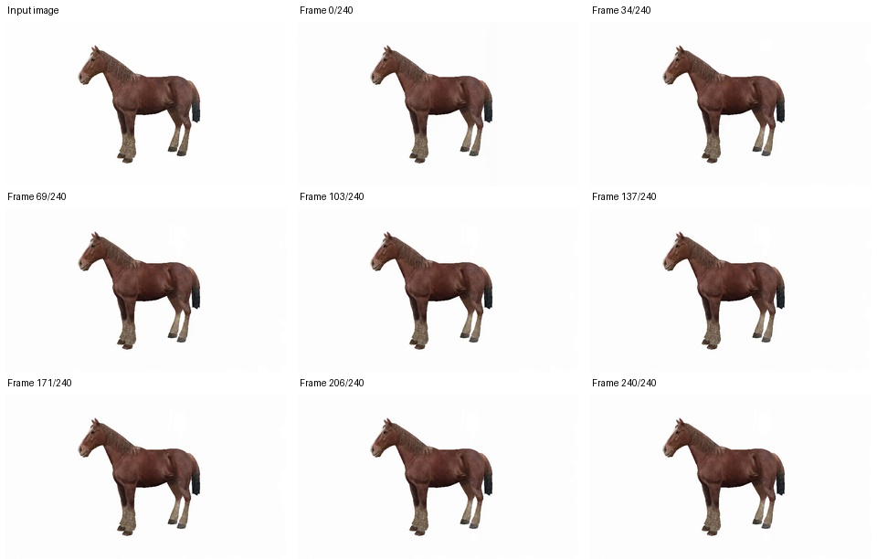
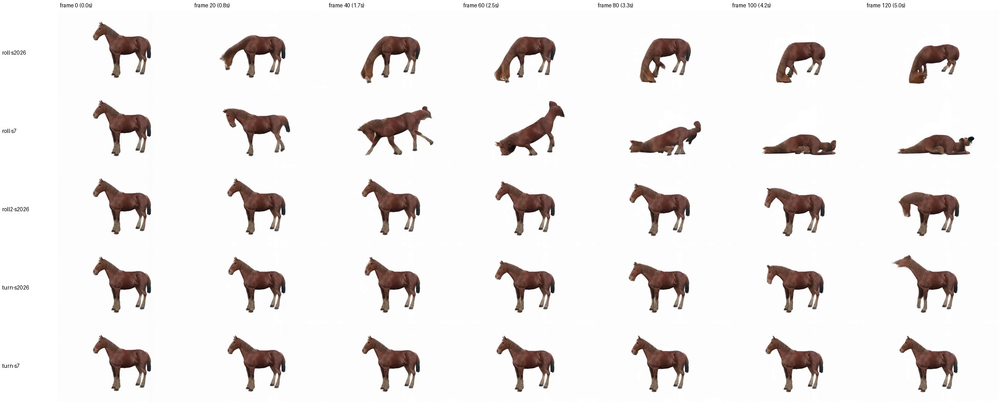

# LTX 2B 馬動作實驗紀錄

2026-11-18 在 RTX A6000（48GB）上，以 `horse_textured` 與 LTX-Video 2B 做的影片生成實驗。
只跑影片階段，尚未接 supervision / joint / FEM。

所有實驗共用：

- 輸入圖：[horse-textured-input.png](asset-previews/horse-textured-input.png)
  （與 `configs/horse-textured-ltx-5s.yaml` 的 canonical render 相同相機）
- 768×448、40 steps、guidance 3.0、CPU offload
- 指令：`bash scripts/07_generate_video.sh docs/asset-previews/horse-textured-input.png <CONFIG> <OUTPUT>`

首次執行下載 `Lightricks/LTX-Video` 約 27GB（T5 text encoder 18GB、transformer 7.2GB、VAE 1.6GB），
放在 repo 的 `.cache/huggingface`。

## 1. 基準：5 秒（121 幀、24fps）

設定：[configs/horse-textured-ltx-5s.yaml](../configs/horse-textured-ltx-5s.yaml)，seed 2026。
去噪 38 秒。

- ✅ 一匹馬、鏡頭背景固定、身體不滑：水平中心 378–381 px，蹄底線維持 y=384。
- ⚠️ 只做出「低頭」：約第 2 秒開始低頭，前 2 秒幾乎靜止；聞地、轉頭、抬蹄都沒有。
- ⚠️ 最後約 1 秒臉部變形、白斑消失（見 [frames-0-90-120.png](ltx-experiments/5s/frames-0-90-120.png)）。

## 2. 20 秒

prompt 改為依時間順序的多個動作。

| 版本 | 設定 | 去噪時間 | 結果 |
| --- | --- | --- | --- |
| A | [481 幀、24fps](../configs/experiments/horse-textured-ltx-20s-A-481f-24fps.yaml) | 2:52 | ❌ 約 3 秒後頭頸融成模糊鬃毛、前腿消失，之後靜止 |
| B | [241 幀、12fps](../configs/experiments/horse-textured-ltx-20s-B-241f-12fps.yaml) | 1:12 | ❌ 幾乎是靜止圖片，外框 20 秒內不變 |

結論：LTX 2B 單次生成 20 秒不可用。A 超過官方建議上限（約 257 幀）；
B 在範圍內但動作被稀釋成不動。若需要長片，要另外實作分段接續。

## 3. 翻身／轉身（5 秒）

五個變體只差 prompt 與 seed，negative prompt 移除與翻身衝突的項目。

| 版本 | prompt | seed | 結果 |
| --- | --- | --- | --- |
| [roll-s2026](../configs/experiments/horse-textured-ltx-roll-s2026.yaml) | 側躺後翻成四腳朝天 | 2026 | ❌ 低頭彎腿，頭腿融合，沒有躺下 |
| [roll-s7](../configs/experiments/horse-textured-ltx-roll-s7.yaml) | 同上 | 7 | ⚠️ 約 3 秒趴倒（腹部朝下），未翻成背朝下；頭與前腿嚴重變形 |
| [roll2-s2026](../configs/experiments/horse-textured-ltx-roll2-s2026.yaml) | 跪下後翻成四腳朝天 | 2026 | ❌ 幾乎不動，最後 1 秒低頭 |
| [turn-s2026](../configs/experiments/horse-textured-ltx-turn-s2026.yaml) | 原地轉身 180° | 2026 | ❌ 幾乎不動，最後頭部拉長模糊 |
| [turn-s7](../configs/experiments/horse-textured-ltx-turn-s7.yaml) | 同上 | 7 | ❌ 全程靜止 |

每列一支影片，每 0.8 秒取一格：

觀察：

- 同一 prompt 只換 seed，結果可差很多（roll-s2026 vs roll-s7）；每組樣本只有 1–2 個，
  還不足以判斷哪種寫法較好。
- 需要看見輸入圖中不可見的身體部位、或身體大幅旋轉的動作，LTX 2B 傾向不動或結構崩壞。
- 即使影片成功，翻身會造成大量自遮擋，且目前 FEM 沒有重力與地面接觸，
  超出此 pipeline 與論文示例（原地局部動作）的範圍。

## 影片

每個資料夾內有 `reference.mp4` 與 `video-review.jpg`：
[5s](ltx-experiments/5s/)、
[20s-A](ltx-experiments/20s-A-481f-24fps/)、
[20s-B](ltx-experiments/20s-B-241f-12fps/)、
[roll-s2026](ltx-experiments/roll-s2026/)、
[roll-s7](ltx-experiments/roll-s7/)、
[roll2-s2026](ltx-experiments/roll2-s2026/)、
[turn-s2026](ltx-experiments/turn-s2026/)、
[turn-s7](ltx-experiments/turn-s7/)。
